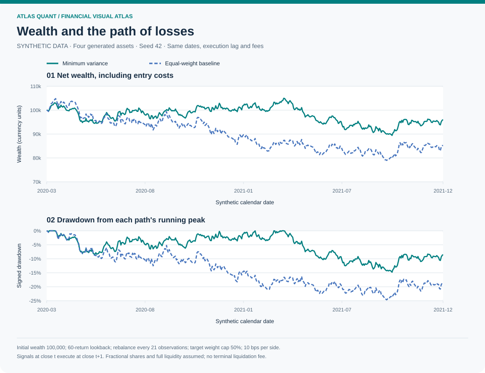
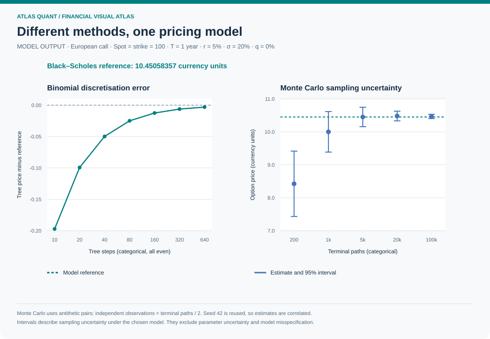
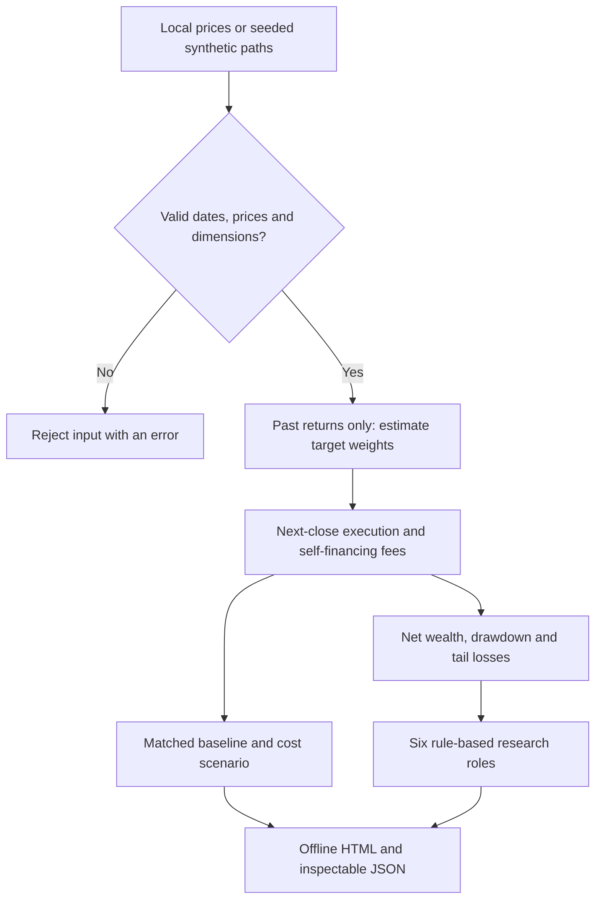
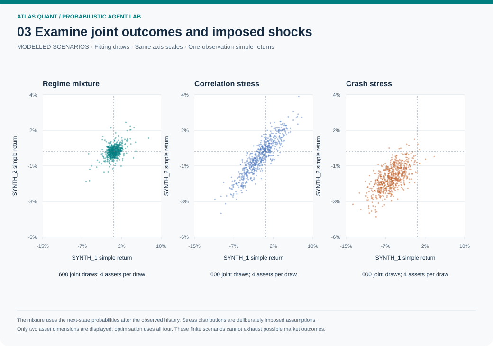

# Atlas Quant

**Financial research you can inspect, reproduce and challenge.**

For educators and research teams: [explore the workshop and team pilot](docs/WORKSHOP_OFFERS.md) or [email Albert](mailto:travelingbert@gmail.com?subject=Atlas%20Quant%20enquiry).

Atlas Quant combines financial mathematics, portfolio experiments and a structured
research council in a small, offline Python package. A single command produces
an accessible HTML report and a machine-readable evidence record. The demo needs
no API key, cloud account, database or paid service.

Version **0.1.0** is a research release. It has no broker adapter and makes no claim
of investment suitability, predictive accuracy or excess returns. The council's
six roles are deterministic analytical rules. Optional external reviews select
validated critique templates; this release does not call language models.

## Public-data research pilot

The [Atlas observatory](docs/OBSERVATORY.md) adds a separate, bounded collector
for current Singapore air-quality observations and licensed, non-commercial
historical BTC/ETH market research. It retains source records, checksums and
replayable evidence, and applies the actual [project Opsbook](docs/opsbook/README.md)
before acquisition. [Scheduled runs and their artifacts](https://github.com/Albertito-AI/atlas-quant/actions/workflows/observatory.yml)
show actual execution, including failures.

The numerical package remains offline. Live exchange connections are disabled
pending the required source-use decisions. Collection, historical backtests and
implementation checks do not establish predictive accuracy, agent learning or
profitable trading. Source data retain their own licences; the code licence does
not override them.

## See the calculations



**Reproducible synthetic experiment.** These paths come from the package's own
backtest engine: four generated assets, seed 42, a 60-observation estimation
window, rebalancing every 21 observations, a 50% target-weight cap and 10 basis
points of cost on each absolute buy or sell notional. Both strategies use the
same calendar, execution lag and cost convention. The curves demonstrate the
accounting and comparison; they provide no evidence of market profitability.

[Open the visual guide](docs/VISUAL_GUIDE.md) for six reproducible charts,
their numerical data, equations, assumptions and source-code links.

| Inspect a question | Visual evidence |
|---|---|
| What does the strategy earn and lose in the simulation? | [Wealth and drawdown](docs/VISUAL_GUIDE.md#wealth-and-drawdown) |
| How sensitive is the result to trading costs? | [Cost scenarios](docs/VISUAL_GUIDE.md#transaction-costs) |
| How do dependence and allocation relate? | [Correlation and holdings](docs/VISUAL_GUIDE.md#allocation-and-dependence) |
| How does an option respond to changing inputs? | [Prices and sensitivities](docs/VISUAL_GUIDE.md#option-prices-and-sensitivities) |
| Do separate valuation methods agree? | [Numerical convergence and sampling error](docs/VISUAL_GUIDE.md#pricing-convergence) |
| What does a tail-risk statistic measure? | [Observed loss distribution](docs/VISUAL_GUIDE.md#tail-risk) |



The pricing experiment compares numerical methods against the analytic value
under identical declared model assumptions. Its intervals measure Monte Carlo
sampling error, not uncertainty about future market prices.

### From data to an inspectable result



The council records evidence and challenges. Its outcomes are `research_only`
or `blocked_for_review`. Every chart has declared inputs; every interpretation
can be checked against the [mathematical conventions](docs/MATHEMATICS.md) and
[validation tests](docs/VALIDATION.md).

## Run it

### Explore five stages of agent reasoning

The [agent lab](docs/AGENT_LAB.md) adds Bayesian regime beliefs, sequential expert
weighting, joint stress scenarios, robust tail-loss optimisation and explicit
research gates. Five new figures connect the equations to their numerical
evidence. Separate validation draws challenge the allocation before review.



```bash
# After installing the package:
atlas-quant agent-lab --output output/agent-lab
```

This is an implemented offline mathematical demonstrator. Its models and
scenarios are synthetic and explicitly parameterised. The guide separately
describes a proposed future AI-planner integration; general intelligence or
superhuman market performance has not been demonstrated.

### Install and run the original portfolio demo

Requires Python 3.11 or newer. Install from this source checkout:

```bash
python -m venv .venv
# Linux/macOS:
source .venv/bin/activate
# Windows PowerShell instead: .venv\Scripts\Activate.ps1
python -m pip install .
atlas-quant demo --output output/demo
atlas-quant verify output/demo/report.json
```

Open `output/demo/report.html` in your browser. The report is self-contained and
uses no remote assets or JavaScript. `--output` must name a new directory so
earlier experiments are preserved. Installation downloads NumPy and SciPy;
analysis runs locally after installation.
To reproduce the locally tested runtime versions, install with
`python -m pip install -c requirements-tested.txt .`.

### Bring your own prices

```csv
date,EQUITY,BONDS
2025-01-02,100.0,100.0
2025-01-03,101.0,99.8
2025-01-06,100.5,100.1
```

Use at least `lookback + 3` rows of adjusted closing prices in one currency.
The tiny example above shows the format only. Supply your own properly licensed
data with a shared calendar and no missing cells.

```bash
atlas-quant backtest prices.csv --strategy minimum_variance \
  --lookback 60 --rebalance-every 21 --cost-bps 10 \
  --max-weight 0.50 --periods-per-year 252 --output output/experiment-01
```

The weight cap must be feasible for the number of assets. Dates must increase
strictly; duplicates, nonpositive prices, nonfinite values and malformed rows
are rejected. The software cannot verify whether an input is correctly adjusted,
survivorship-free or denominated in a common currency. Set the annualisation
frequency to match your observations. CSV loading never silently fills gaps.

### Compare pricing methods

```bash
atlas-quant options --spot 100 --strike 100 --maturity 1 \
  --rate 0.05 --volatility 0.20 --option call
```

This compares Black–Scholes, a binomial tree and seeded antithetic Monte Carlo
for the same European payoff. Rates and yields are continuously compounded;
volatility is annualised; maturity is in years. The Python API also supports
American exercise in the tree. Model assumptions and edge cases are documented
in [Mathematics](docs/MATHEMATICS.md).

## What is included

| Component | Implemented behaviour |
|---|---|
| Price ingestion | Bounded CSV parsing, strict validation, date/asset ordering and a dataset content hash |
| Portfolio research | Equal weight, capped inverse volatility, and capped minimum variance with fixed diagonal shrinkage |
| Execution accounting | Signals at close t execute at close t+1; held assets receive returns before rebalance; fees solve a self-financing equation |
| Comparison | Equal-weight baseline on the same dates with the same lag and costs, plus a doubled-cost sensitivity scenario |
| Risk | Initial-wealth-aware drawdown, sample volatility, Sharpe, empirical value at risk and fractional-tail expected shortfall |
| Derivatives | Dividend-aware Black–Scholes, analytic Greeks, European/American trees, Monte Carlo and sampling intervals |
| Research council | Six transparent roles, traceable numeric evidence, dissent and non-overridable data/risk gates |
| External reviews | Size-bounded JSON, fixed critique codes, role and citation validation; no arbitrary prose, tools or execution |
| Reports | Responsive offline HTML with charts, holdings, risk, costs, assumptions and evidence; JSON content-integrity checks |
| Engineering | Numerical identity tests, hand-calculated accounting, future-data perturbation tests, adversarial input tests and clean-wheel checks |

The content hash detects accidental or uncoordinated edits. Anyone with the
content can recompute it; it is neither an author signature nor proof that the
underlying data are true.

## How the source projects informed this work

The requested study covered
[AI-Investment-Advisor](https://github.com/neohsiung/AI-Investment-Advisor) and
[FinMathematics](https://github.com/PlamenStilyianov/FinMathematics).

| Lesson | Atlas Quant design |
|---|---|
| Separate agent proposals from deterministic decisions | Calculations create the evidence; council roles and external reviews cannot place trades or change values |
| Make missing evidence visible | Undefined statistics remain missing; missing evidence and risk breaches trigger explicit gates |
| Prevent research shortcuts | Built-in strategies receive past returns only; execution lag and fee accounting are enforced in the simulator |
| Connect theory to executable checks | Pricing identities, finite-difference Greeks, tree convergence and an independent cash ledger anchor the test suite |
| Keep deployment understandable | Offline package and report, without broker keys, database services or a scheduler |
| Respect source provenance | Original implementation; no books, solution manuals or Mathematica code redistributed |

These are targeted design improvements for reproducible research. Atlas Quant
does not match the upstream platform's live trading, live market feeds, news
retrieval, distributed operations or provider integrations. It has not been
independently audited or benchmarked as superior to those systems.

See the [pinned source study](docs/SOURCE_STUDY.md) for inspected paths, findings,
licence observations and limits of the study. [NOTICE](NOTICE) records attribution.

## Development and evidence

```bash
python -m pip install .
python -m unittest discover -s tests -v
python scripts/security_check.py
python -m pip install build
python -m build
```

The six development agents each recorded 20 numbered study, construction and
review passes, including challenges and corrections, in
[the review directory](docs/reviews). These are development records from six
concurrent agents, not 120 independently deployed agents or 120 external audits.
The development agents are separate from the product's six rule-based council roles.

The repository includes a Python 3.11–3.13 GitHub Actions workflow and dependency
audit. A committed workflow is not evidence that a remote CI run passed. Consult
[Validation](docs/VALIDATION.md) and [the release verification record](docs/RELEASE_CHECKS.md)
for the observed checks and limitations.

## Training and implementation

[Explore the workshop and research-workflow pilot](docs/WORKSHOP_OFFERS.md).
The workshop includes a [reproducible synthetic case](docs/WORKSHOP_CASE.md).

## Further reading

- [User guide](docs/USER_GUIDE.md)
- [Visual guide: charts, workflow and reproducible data](docs/VISUAL_GUIDE.md)
- [Five-stage agent lab and future integration boundaries](docs/AGENT_LAB.md)
- [Reproducible workshop case](docs/WORKSHOP_CASE.md)
- [Mathematical conventions and sources](docs/MATHEMATICS.md)
- [Council architecture and external review schema](docs/AGENT_DESIGN.md)
- [Threat model and reporting vulnerabilities](SECURITY.md)
- [Contributing](CONTRIBUTING.md)
- [Roadmap](docs/ROADMAP.md)

MIT licensed original code, copyright 2026 Albert Tan Sin Hon.

