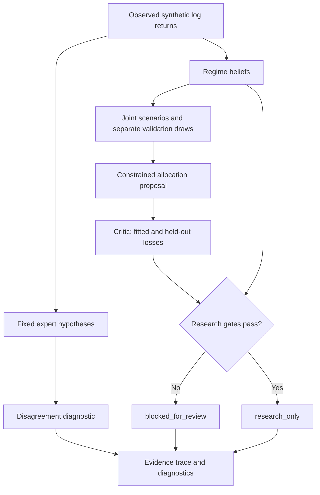
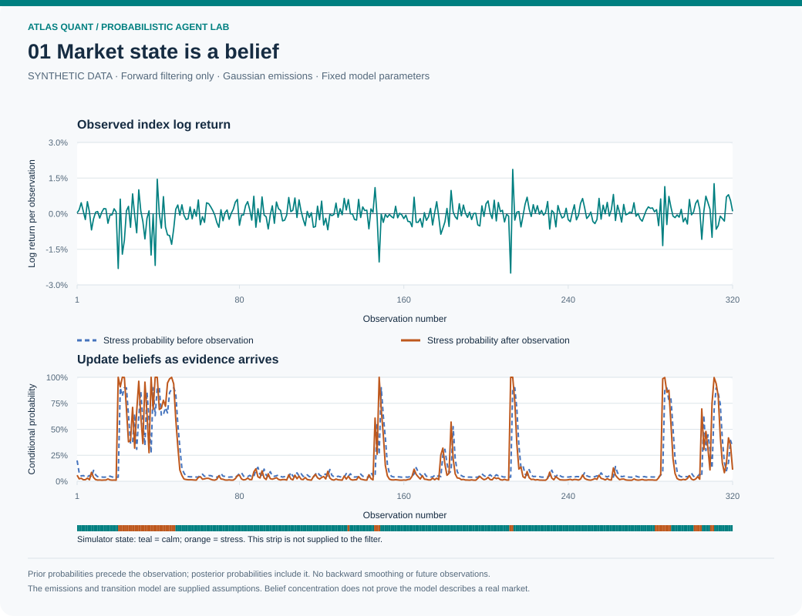
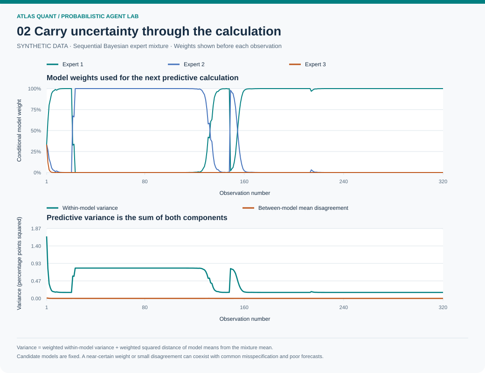
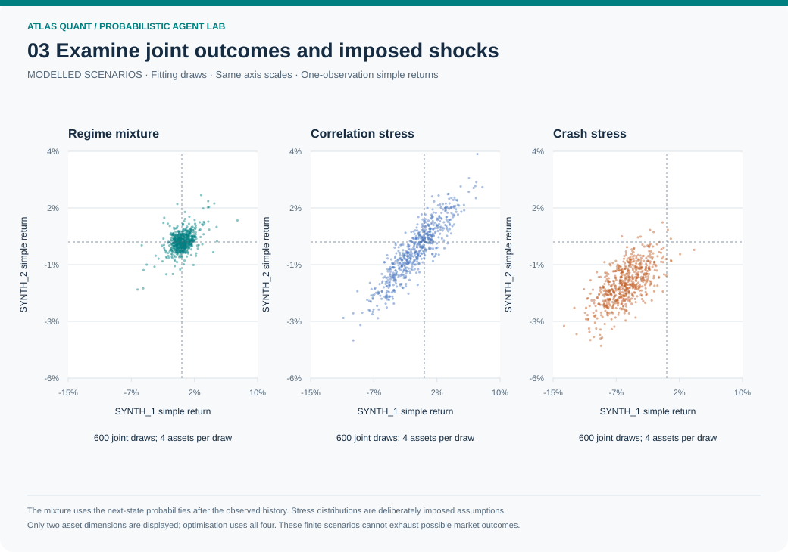
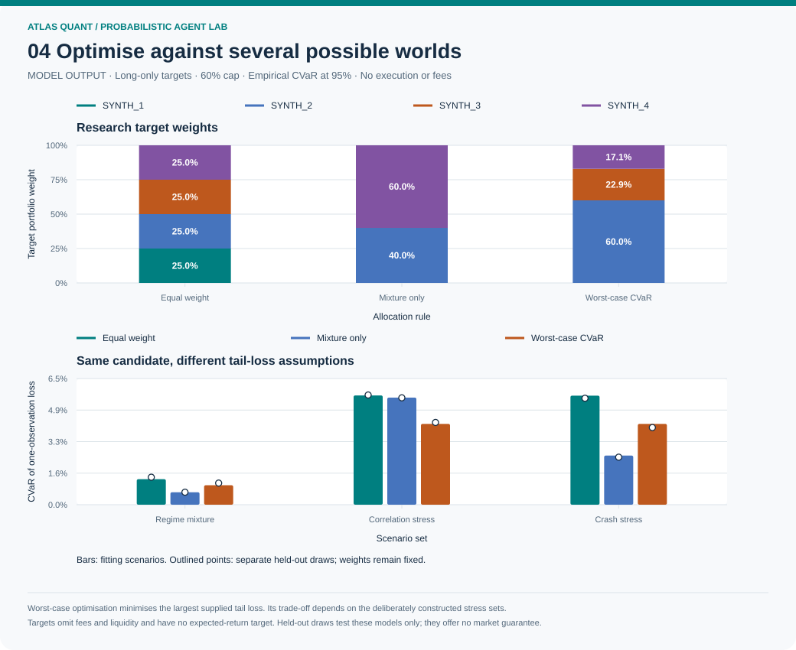
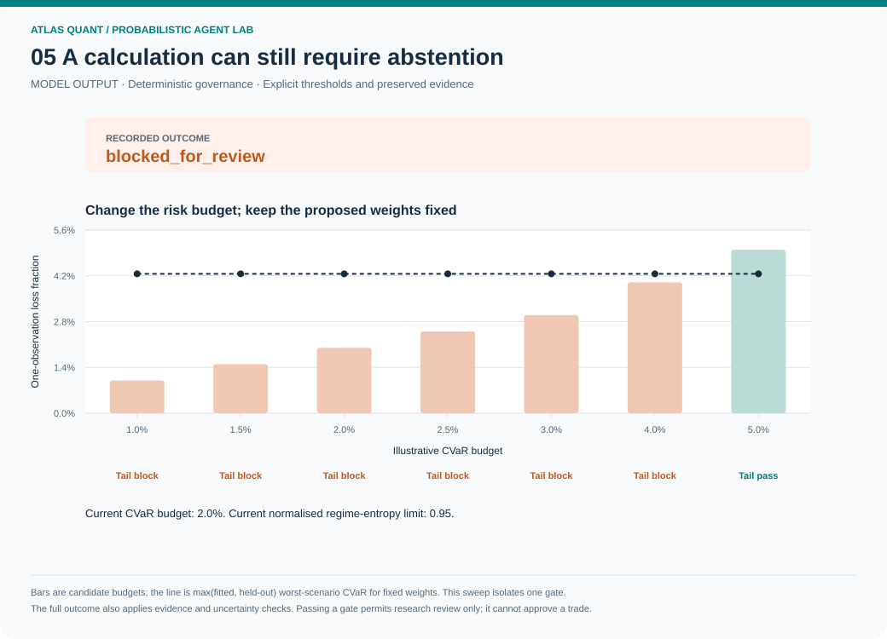
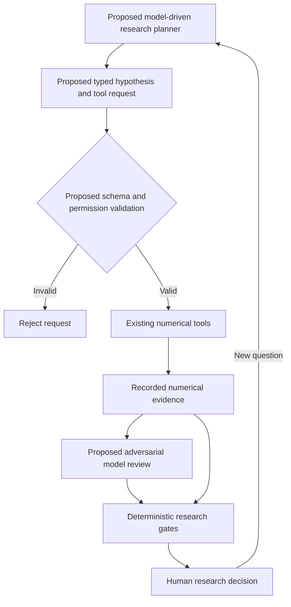

# Five stages of computational market reasoning

Atlas Quant's agent lab makes a more demanding research process visible: infer
hidden conditions, compare forecasts, construct joint scenarios, propose a
constrained allocation and challenge it before further interpretation.
Each stage emits numerical evidence that the next stage can inspect.

**Implemented scope:** deterministic Python calculations over a synthetic
four-asset model. The lab runs locally with no language-model API, live market
feed or broker. Its five stages describe analytical responsibilities. It does
not deploy five autonomous AI models or demonstrate artificial general intelligence.

The interesting computational advantage is the ability to retain many conditional
calculations together. A default run processes 320 observations, maintains
separate regime and expert beliefs, and evaluates 3,600 four-asset scenario draws
across fitting and validation samples. The equations remain understandable and
the evidence can be reproduced. Calculation scale alone establishes neither
market insight nor general intelligence.

## Run and inspect

```bash
python -m pip install .
atlas-quant agent-lab --seed 2026 --observations 320 \
  --scenario-count 600 --output output/agent-lab
python scripts/build_agent_lab.py --check
```

Open `output/agent-lab/report.html`. It contains the computed plots, proposals,
challenge results and evidence trace. `lab.json` preserves the actual arrays,
declared parameters, random seed and content digest. Choose a fresh output
directory for each experiment. The lab has its own schema, `agent-lab-1.0`;
the existing `atlas-quant verify` command remains specific to backtest reports.
For the lab digest, use `atlas_quant.agent_lab.verify_agent_lab(record)`.
Digest checking detects content changes relative to the saved digest; it does
not validate a market model or authenticate an author.

The five repository figures below are generated by
[`build_agent_lab.py`](../scripts/build_agent_lab.py). Their
[data and manifest](assets/agent-lab/data/) preserve numerical provenance.
Run the script without `--check` to regenerate the committed gallery.

Python sources and generated SVG, CSV and JSON files use LF line endings in
both the working tree and generated output. The repository's `.gitattributes`
preserves these bytes with `core.autocrlf` enabled. See the
[visual guide](VISUAL_GUIDE.md#reproduce-the-gallery) for existing-checkout advice.

| Stage | Calculation now implemented | What an agent would inspect |
|---|---|---|
| 1. Regime observer | Forward Gaussian hidden-state filtering | Competing explanations for current observations |
| 2. Forecast challengers | Sequential Bayesian expert weights and variance decomposition | Disagreement, predictive density and concentration on one hypothesis |
| 3. Scenario analyst | Correlated conditional draws and explicitly imposed shocks | Joint exposures and failures of apparently protective assets |
| 4. Allocation proposer | Worst-scenario conditional value-at-risk minimisation | A feasible target that balances the supplied stress sets |
| 5. Critic and governor | Separate validation draws and hard research gates | Residual tail loss, uncertainty, sample size and reasons to stop |



Expert disagreement is recorded for inspection. The current hard gates use
sample counts, regime-belief entropy and the worst scenario tail loss; they do
not use an invented consensus confidence score.

## 1. Maintain beliefs about unobserved conditions



The observer receives the average of four one-observation log returns. Two
declared Gaussian states represent calm and stressed conditions. Given the
previous posterior $b_{t-1}$ and transition matrix $A$, it first predicts a state
distribution, then incorporates the newly observed return $x_t$:

$$
b^-_t(j)=\sum_i b_{t-1}(i)A_{ij},\qquad
b_t(j)=\frac{b^-_t(j)p(x_t\mid j)}{\sum_k b^-_t(k)p(x_t\mid k)}.
$$

For the first observation the supplied prior is used directly. The predictive
mean and variance are recorded **before** consuming $x_t$; the posterior uses
observations through $t$. Forward filtering avoids the future observations that
retrospective smoothing would use. The next-step scenario mixture uses the final
posterior after applying the transition matrix once more.

The simulator's states are displayed for diagnosis only. They never enter the
filter as observed labels. Its emission and transition parameters are known by
construction, which makes this a favourable demonstration of inference. Real
markets would require parameter estimation, dated data controls and evaluation
under misspecification. The returned probabilities condition on this model;
they are not probabilities of making money.

Code: [`beliefs.py`](../src/atlas_quant/beliefs.py). Method: Rabiner (1989),
[§III.A, equations 18–21](https://web.mit.edu/6.435/www/Rabiner89.pdf), with
Gaussian continuous observation densities.

## 2. Preserve competing hypotheses and their uncertainty



Three fixed Gaussian experts represent a narrow positive, broad neutral and
wide negative return distribution. Before each observation, the system records
their mixture prediction. Afterwards it scores the observation's predictive
density and updates weights:

$$
q_{t+1,k}\propto q_{t,k}\,p_k(x_t),\qquad
\bar\mu_t=\sum_k q_{t,k}\mu_k.
$$

The predictive variance retains both within-expert variation and disagreement
between expert means:

$$
V_t=\sum_k q_{t,k}\sigma_k^2+
\sum_k q_{t,k}(\mu_k-\bar\mu_t)^2.
$$

These quantities use one-observation log-return units; variances use their
squares. The implementation updates in log space to preserve hypotheses whose
displayed probabilities become extremely small. Log predictive density is a
natural logarithm of a density, which can be positive. It is not a probability
bounded by one.

The experts have fixed parameters and no forgetting mechanism. Cumulative
weights can adapt slowly when conditions change. Between-expert dispersion is
only one limited source of model uncertainty; shared errors and parameter
uncertainty remain outside the calculation. Concentration on one expert can
coexist with a badly specified candidate set.

Code: [`online_gaussian_experts`](../src/atlas_quant/beliefs.py). Foundation:
Hoeting and colleagues (1999), [mixture probabilities and predictive
variance, §1; predictive scoring, §6](https://sites.stat.washington.edu/www/research/online/hoeting1999.pdf).

## 3. Examine joint outcomes and imposed shocks



Scenario analysis concerns how assets move together. A low marginal volatility
can provide little protection when dependence rises or the asset itself is
shocked. The lab retains three sets of 600 equally weighted draws:

| Scenario set | Declared construction |
|---|---|
| `regime_mixture` | Draw a next state using filtered next-state probabilities, then draw four correlated Gaussian log returns from that state |
| `correlation_stress` | Set pairwise log-return correlation to 0.90 and impose a loss in the normally low-volatility fourth asset |
| `crash_stress` | Impose negative log-return means with the stressed regime's covariance |

The latter two are deliberately constructed challenges. They have no estimated
occurrence probabilities. Exact means, standard deviations and correlations
are saved in `model.stresses`; these values are assumptions, not observations
or claims about named securities. There is no fitted causal model of why a
shock occurs.

For each set, correlated log returns are converted to simple returns using
$R_i=\exp(X_i)-1$. A portfolio's one-observation simple return is $w^\top R$.
The average log return used by the regime observer is a separate signal and is
never substituted for that portfolio return.

Three independent random streams generate history, optimisation scenarios and
validation scenarios. The last stream supplies another 1,800 draws after the
optimisation inputs are fixed. All draws remain conditional on the same stated
models. A separate random stream challenges sampling sensitivity; it does not
establish external validity or cover every possible future.

Code and full parameters: [`agent_lab.py`](../src/atlas_quant/agent_lab.py).

## 4. Optimise against the supplied tail losses



The proposer compares equal weights, an allocation optimised for the regime
mixture alone, and an allocation optimised against the worst supplied scenario
set. All are evaluated across the same sets and again on held-out draws.
The optimiser chooses fully invested, long-only weights with a 60% asset cap.

For loss $L_{s,j}(w)=-R_{s,j}^\top w$ in scenario set $s$, confidence $c=0.95$,
and $N_s$ equally likely draws:

$$
\operatorname{CVaR}_{c,s}(w)=
\min_{\eta_s}\left[\eta_s+
\frac{1}{N_s(1-c)}\sum_j\max(L_{s,j}(w)-\eta_s,0)\right].
$$

The robust proposal solves

$$
\min_w\max_s\operatorname{CVaR}_{c,s}(w),\qquad
\sum_i w_i=1,\quad 0\leq w_i\leq0.60.
$$

Auxiliary variables turn this into a sparse linear programme. Every resulting
objective is independently recomputed with the empirical fractional-tail
estimator. The solver must report success and satisfy the constraints; failure
never becomes fabricated weights. Negative expected shortfall is retained if
the relevant tail consists entirely of gains.

Robustness here is limited to the supplied scenario sets. Favourable in-sample
comparison is partly a consequence of the optimisation objective. Held-out
results can be worse and are shown separately. These are hypothetical target
weights with no transaction costs, execution lag or wealth backtest. The
existing backtest engine retains its own cost and timing conventions.

Code: [`scenarios.py`](../src/atlas_quant/scenarios.py). Foundation:
Rockafellar and Uryasev, [general loss distributions, Theorems 10 and 14,
equations 49–51](https://sites.math.washington.edu/~rtr/papers/rtr187-CVaR2.pdf).

## 5. Challenge the proposal and retain the right to stop



An optimiser finds a feasible answer to its mathematical problem. The governor
asks whether the evidence meets separately declared research criteria. It uses
the greater of fitted and held-out worst-scenario expected shortfall, together
with these illustrative gates:

| Evidence | Default gate |
|---|---|
| Observed sample | At least 120 observations |
| Draws in each scenario set | At least 400 |
| Normalised next-regime entropy | At most 0.95 |
| Worst fitted or held-out 95% expected shortfall | At most 2% over one observation |

Entropy is $-\sum_k p_k\log p_k/\log K$. It measures dispersion within the
declared state model. Low entropy cannot certify that the model is correct.
The thresholds are transparent teaching choices, without a statistical
sufficiency or investment-suitability claim. Missing or invalid evidence blocks
review. A strong outcome elsewhere cannot cancel that block.

The risk-budget figure changes only the tail threshold to show the sensitivity
of that single gate. It is not a procedure for raising the budget until a
preferred answer passes. The full decision retains every gate and yields
`blocked_for_review` or `research_only`. Neither outcome permits order placement.

Code: [`review_lab_evidence`](../src/atlas_quant/agent_lab.py). The trace stores
input and output references for every stage, enabling readers to follow the
evidence without relying on persuasive narrative.

## What a future general research agent would require

The present lab supplies bounded numerical tools and an inspectable evidence
contract. A proposed future model-driven planner could formulate hypotheses,
request additional data, choose tests, compare mechanisms and commission
adversarial reviews. Each proposed capability would need its own implementation
and evaluation. The diagram below is an **unimplemented integration proposal**:



A model's explanation would remain a proposal linked to evidence identifiers.
It could not replace computed losses, rewrite provenance, bypass a failed gate
or convert a research outcome into a trade. Novel causal discovery, learned
representations, calibrated real-data forecasts, autonomous hypothesis search
and independent live evaluation are outside the current implementation.

General intelligence and exceptional financial capability require defined tasks,
meaningful baselines and independent evaluation. The distinction between depth
of performance, generality and autonomy is discussed by Morris and colleagues
in [*Levels of AGI* (2024)](https://proceedings.mlr.press/v235/morris24b.html).
No benchmark in this repository establishes those capabilities. Its advanced
calculations are intended to be examined, reproduced and challenged.
