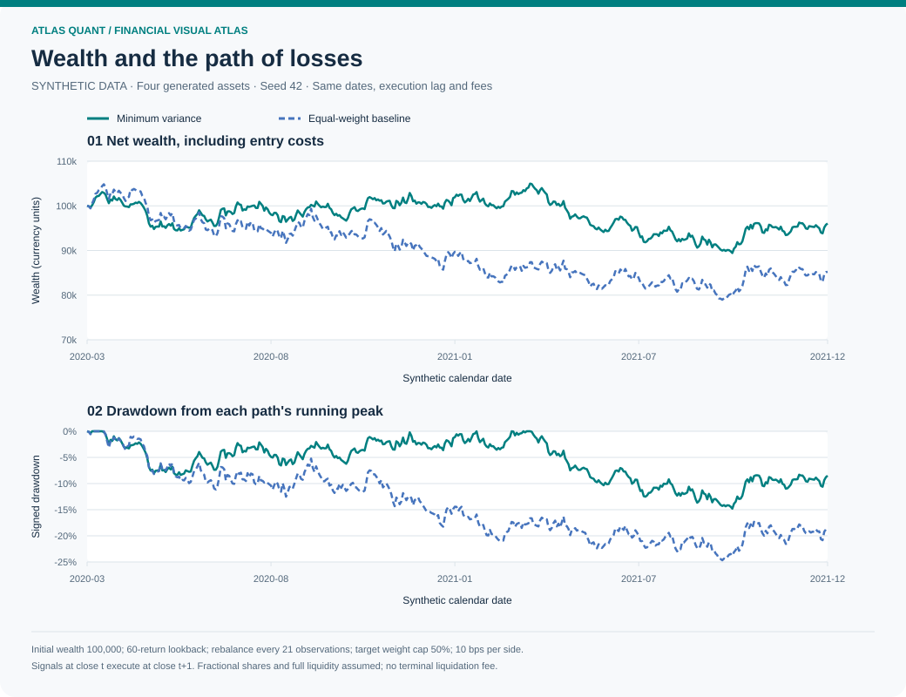
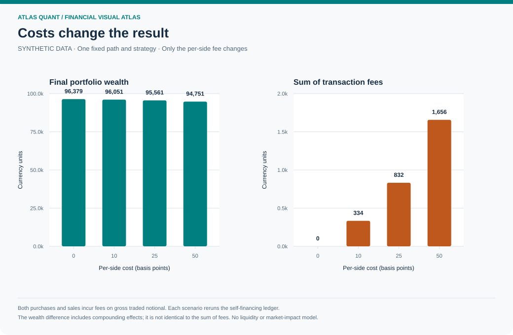
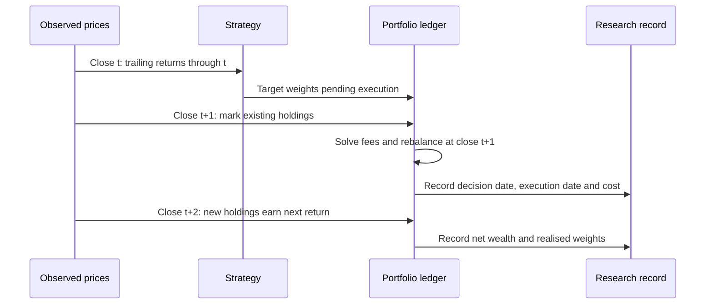
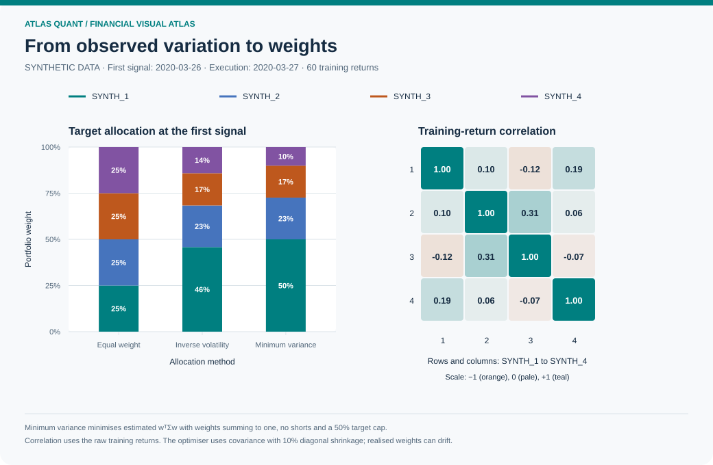
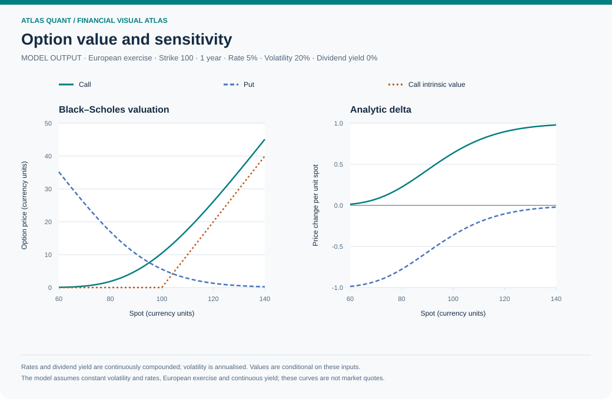
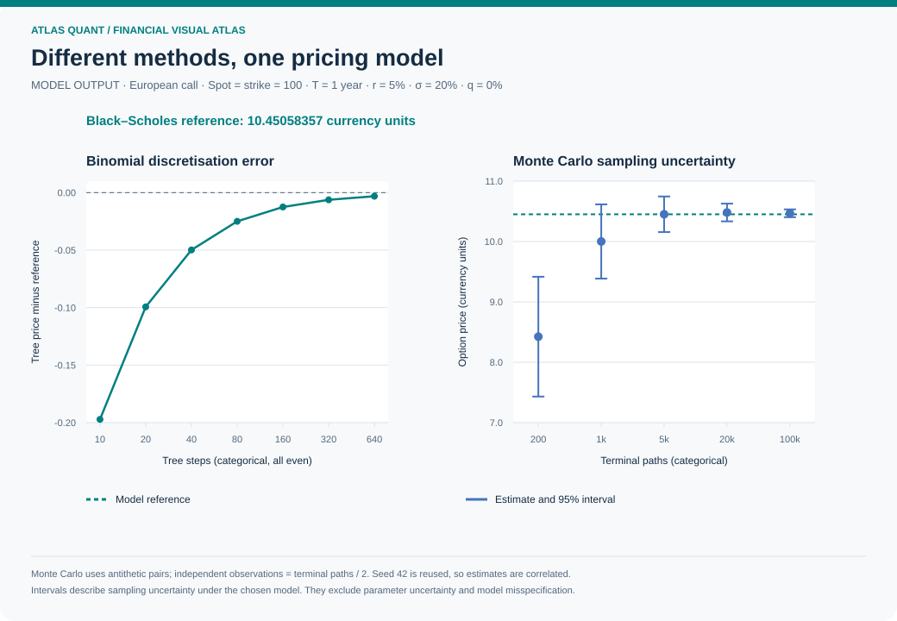
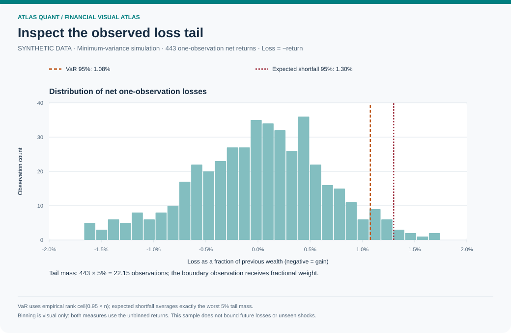
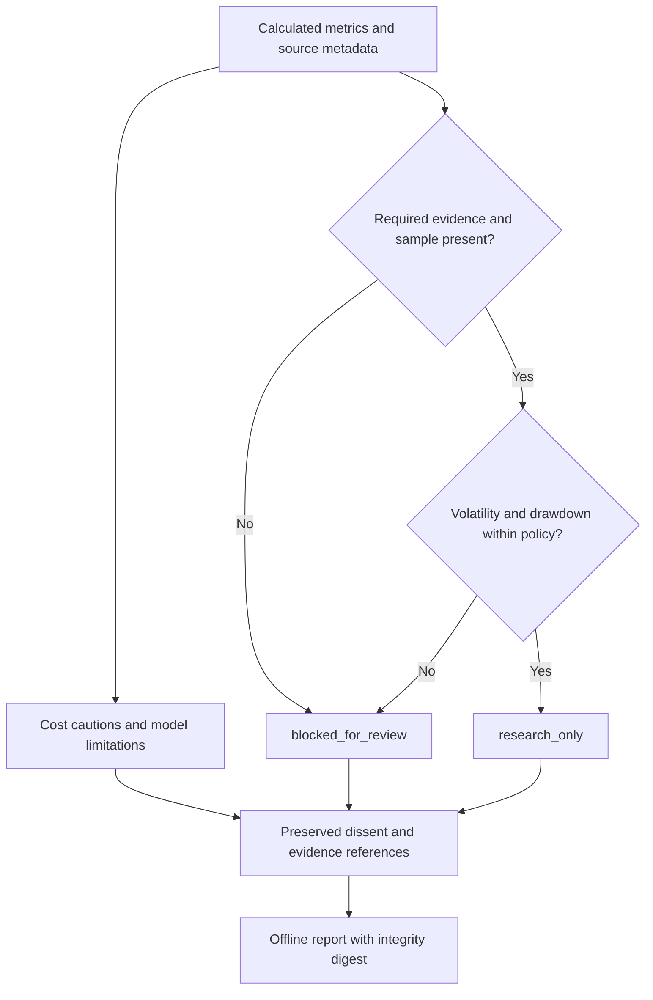

# Atlas Quant, visually explained

These figures expose the financial calculations, timing conventions and research
controls implemented in Atlas Quant. Each numerical figure is generated by
[`scripts/build_visuals.py`](../scripts/build_visuals.py) using the package's
public calculations. The accompanying [data directory](assets/data/) contains
the observations used to draw the figures. The workflow diagrams describe code
paths; they are not empirical results.

The portfolio examples use **synthetic data**, generated with seed 42. The option
examples use **declared model inputs**. Neither is a record of actual trading,
an independently audited result or a forecast. Readers can reproduce the
figures, inspect the calculations and challenge the assumptions.

## Reproduce the gallery

From the source checkout, with Python 3.11 or newer:

```bash
python -m pip install -c requirements-tested.txt .
python scripts/build_visuals.py
python scripts/build_visuals.py --check
python -m unittest discover -s tests -v
python scripts/security_check.py
```

The generator runs offline after installation. It writes SVG images and numerical
data into `docs/assets/`. SVGs use text, axes and explicit units, with no remote
assets or executable content. The check command recomputes the numerical evidence
using declared tolerances, then checks rendered files against the committed
evidence and manifest. The manifest records Python, NumPy and SciPy versions
alongside source and output hashes. Small floating-point differences across
numerical library versions are expected; a changed image alone does not establish
a financial error. Preserve the fixed settings when comparing
revisions rather than searching for a more attractive path.

| Portfolio input | Fixed gallery setting |
|---|---|
| Price rows and assets | 504 rows, four generated assets |
| Generator | `synthetic_prices(days=504, assets=4, seed=42)` |
| Calendar | Generated weekdays beginning 2 January 2020; exchange holidays omitted |
| Strategy | Long-only minimum variance, 10% diagonal covariance shrinkage |
| Estimation and rebalance | 60 trailing return observations; every 21 observations |
| Target-weight cap | 50% per asset at rebalance |
| Initial wealth | 100,000 illustrative common-currency units |
| Execution | Signal after close t; execution at close t+1 |
| Base cost | 10 basis points on every absolute traded notional |
| Annualisation | 252 observations per year |
| Baseline | Equal weight with the same calendar, lag and cost convention |

The 504 input rows include warm-up. Evaluation starts at the first signal close
and contains 443 return intervals. Cash initially earns zero; the first executed
purchase incurs a fee. End holdings are marked to market without liquidation.

## Wealth and drawdown



Read the two panels together. Wealth records the compounded outcome after fees;
drawdown records the decline from each path's own previous high, including its
initial capital. A higher ending value can coexist with a deeper interim loss.
Both strategies retain unfavourable parts of the generated path.

For net portfolio returns $r_t$:

$$
W_t=W_0\prod_{j=1}^{t}(1+r_j),\qquad
D_t=\frac{W_t}{\max_{0\leq j\leq t}W_j}-1.
$$

Drawdown curves are signed and at or below zero. The summary metric
`max_drawdown` stores the positive magnitude of the largest loss from a peak.
The path starts with the first signal date's cash balance, before the entry fee.
See [`run_backtest`](../src/atlas_quant/backtest.py) and
[`drawdown`](../src/atlas_quant/quant.py).

## Transaction costs



Each cost point reruns the same strategy on the same prices with the same signal
dates. One basis point is 0.0001 of traded notional. Purchases and sales both
count, including the initial entry. The costs are paid from portfolio wealth.
These scenarios vary a proportional fee; they do not estimate liquidity, bid-ask
spread dynamics, taxes or price impact.

Let $V^-$ be pre-trade wealth, $h_i^-$ the value of each existing asset holding,
$w_i$ the target weight and $c$ the per-side fee fraction. The ledger solves for
investable post-cost wealth $V^+$:

$$
V^+ + c\sum_i\left|w_iV^+-h_i^-\right|=V^-.
$$

Thus purchases cannot spend money already needed to pay the fee. From cash,
with fully invested weights, this simplifies to $V^+=V^-/(1+c)$.
The recorded `total_transaction_cost` sums monetary fees.
`total_cost_fraction` instead sums each fee divided by that trade's pre-trade
wealth. Their denominators differ, so the latter must not be labelled as the
percentage of initial capital spent. See the independent cash-ledger checks in
[`test_backtest.py`](../tests/test_backtest.py).

### When information becomes investable



The initial pending allocation begins from cash. Later rebalances use the old
holdings through the execution close. This timing prevents the newly chosen
weights from receiving a return that occurred before their assumed purchase.

## Allocation and dependence



The correlation panel uses only the first 60 training returns. The allocation
panel compares equal-weight, inverse-volatility and minimum-variance targets
from that same information set, at the first signal close on 26 March 2020.
Execution occurs at the next generated close, 27 March 2020. Correlation is
dimensionless and measures linear dependence in that window; it does not predict
dependence in another regime. Every later backtest decision likewise receives
only its trailing window.

Minimum variance solves

$$
\min_w w^\top\widehat\Sigma w
\quad\text{subject to}\quad
\sum_iw_i=1,\quad 0\leq w_i\leq 0.50.
$$

For this strategy, the covariance supplied to the solver is
$\widehat\Sigma=0.90S+0.10\operatorname{diag}(S)$, where $S$ is the sample
covariance of the trailing returns. The cap applies to target weights at a
rebalance. Realised weights drift with prices between rebalances and can exceed
the target cap. Asset allocations start at zero while the portfolio is in cash.

The objective concerns estimated variance. It contains no expected-return
estimate and cannot establish an optimal future return. The implementation
checks solver success and feasibility; it does not replace failure with invented
weights. See [`strategy_weights`](../src/atlas_quant/backtest.py),
[`minimum_variance`](../src/atlas_quant/quant.py) and the
[mathematical conventions](MATHEMATICS.md#capped-minimum-variance).

## Option prices and sensitivities



The curves are evaluations of the European Black–Scholes model with continuous
dividend yield. Spot and strike use the same illustrative currency unit;
maturity is in years; rate and volatility are annualised fractions. The figure
states its fixed inputs and which input varies. Prices are values per option
unit, with no contract multiplier.

The plotted delta is the local price derivative with respect to spot. The API
also supplies vega, the derivative
with respect to volatility; the API returns it per 1.0 volatility change, so a
display per percentage point divides that value by 100. Curvature and changing
sensitivities explain why a linear approximation becomes less accurate for
large input changes. Model values and Greeks are computed by
[`black_scholes` and `option_greeks`](../src/atlas_quant/quant.py).

For fixed inputs, the independently testable put-call relationship is

$$
C-P=Se^{-qT}-Ke^{-rT}.
$$

The model assumes constant volatility and rates, European exercise and a
continuous dividend yield. It excludes discrete dividends, jumps and an implied
volatility surface. The guide's theoretical references are linked in
[Mathematics](MATHEMATICS.md#european-option-valuation).

## Pricing convergence



Separate numerical methods value the same European payoff. The binomial tree
uses increasingly fine time grids; its approximation error need not shrink
at every adjacent step count. This figure uses even step counts only. Monte
Carlo uses seeded antithetic draws, reusing seed 42 at each sample size; the
displayed estimates are consequently correlated. Both horizontal axes use
categorical spacing, as labelled.
An interval around a Monte Carlo estimate measures simulation sampling
uncertainty conditional on the chosen model and inputs.

For $M$ independent antithetic pair averages $A_i$:

$$
\widehat V=\frac{1}{M}\sum_i A_i,\qquad
\operatorname{SE}(\widehat V)=\frac{s_A}{\sqrt{M}}.
$$

Two terminal payoffs within a pair are dependent; they must not be counted as
independent observations. A 95% normal-approximation sampling interval is not a
range for the future market price and can miss the analytic value in a particular
run. Method agreement checks the numerical implementation of shared assumptions;
it cannot validate those assumptions against a market.
See [`test_quant.py`](../tests/test_quant.py) for reference values, put-call
parity, finite-difference Greeks and an independent pair-average calculation.

## Tail risk



Loss is the negative of net portfolio return. Positive values are losses and
negative values are gains. The chart shows one-observation outcomes from the
synthetic backtest. At confidence $c$ and sample size $n$, value at risk is the
ascending loss observation at rank $\lceil cn\rceil$. Expected shortfall averages
exactly the worst $n(1-c)$ observations, including fractional weight on the last
observation when necessary.

These empirical statistics describe losses in this sample. They cannot reveal
unseen crashes or establish a maximum possible loss. The implementation's
quantile convention and a hand-calculated fractional-tail example appear in
[Mathematics](MATHEMATICS.md#empirical-tail-risk).

## How evidence reaches a research outcome



These are deterministic review rules, using the same evidence. A favourable
performance observation cannot override a missing-data or risk blocker. The
policy and evidence references remain in the report; no role can authorise a
trade. Synthetic-data cautions remain visible even if numeric gates pass.

A content digest helps detect edits relative to the recorded digest. It is not
an author signature or proof of truthful input. Review the
[council design](AGENT_DESIGN.md) and [validation boundaries](VALIDATION.md)
alongside the figures. Confidence should rest on reproducible evidence and
independent checks, with the remaining empirical questions visible.
